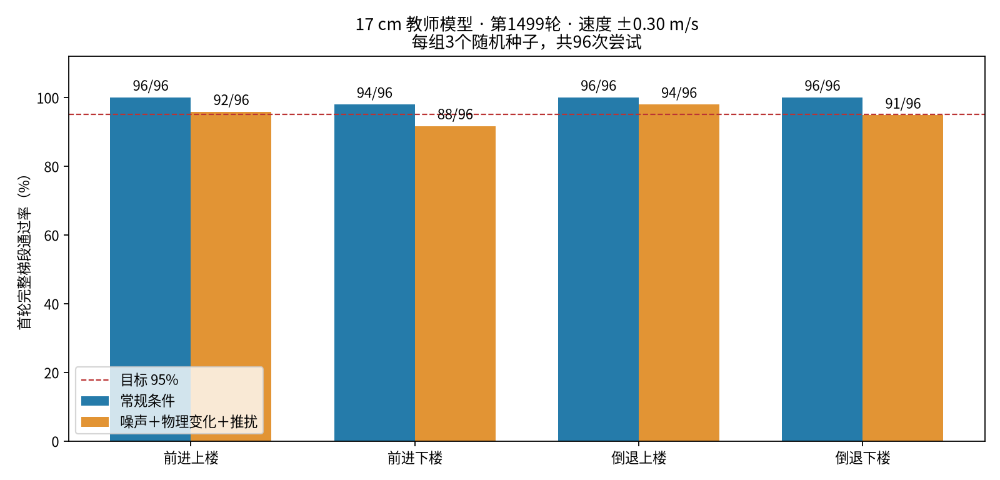

# BPX Quadruped Reinforcement Learning

**English** | [简体中文](README.zh-CN.md)

An Isaac Lab / RSL-RL locomotion project based on MIRRORME BPX. The goal is to **use privileged terrain information during training and deploy a camera-free policy**. The current terrain target is **17 cm risers with 30 cm treads**, traversed forward and backward, uphill and downhill.

## Motor specification update — November 6, 2026

Hip/knee peak effort limits now use 20/40 Nm. Rated speeds of 12/10 rad/s are used as conservative operating caps, not measured maximum speeds. Position targets are clipped to the URDF angle ranges. See the [specification audit and remaining identification work](docs/bpx-motor-spec-alignment.zh-CN.md). Published checkpoints and results below used uniform 30 Nm / 20 rad/s; they are not qualification results under the new hardware profile. The first 3,000-iteration blind student completed but failed qualification; teacher repair and motor adaptation have been paused at the user’s request, with the iteration-600 checkpoint preserved. No robot deployment has occurred.

## Published experiment — November 5, 2026, legacy motor limits

- A **235-D PPO teacher** completed this 1,500-iteration fine-tuning trial and the full evaluation suite.
- The [iteration-1499 teacher checkpoint, configuration snapshots, per-attempt outcomes and SHA-256 manifest](pretrained/bpx_stairs17_teacher/) are included in ordinary Git; no Git LFS is required.
- The teacher **has not passed every robustness target**: forward descent is 91.7%, backward descent 94.8%, below the 95% per-mode gate.
- The first **900-D blind student** completed training and evaluation but failed qualification. Teacher repair, motor adaptation and student improvement remain in progress. The included teacher requires terrain input and is not a camera-free deployment policy.

| 17 cm traversal | Nominal | Noise + physics variation + pushes | Physical failures under perturbations |
|---|---:|---:|---:|
| Forward ascent | 96/96 (100%) | 92/96 (95.8%) | 0 |
| Forward descent | 94/96 (97.9%) | 88/96 (91.7%) | 4 |
| Backward ascent | 96/96 (100%) | 94/96 (97.9%) | 0 |
| Backward descent | 96/96 (100%) | 91/96 (94.8%) | 5 |

Speed: ±0.30 m/s; seeds: 2026/2027/2028; 96 **first-attempt complete-flight traversals** per cell. Success after automatic resets is excluded. Single-seed nominal regression at 8/12/15 cm passed all 384 attempts. Perturbations include observation noise, material properties, mass, center of mass and pushes. These finite simulation results do not establish real-robot reliability.



See the [experiment report](docs/stairs17-results.zh-CN.md) for provenance, failure analysis and next steps.

## Method and policy contracts

```text
Simulation: proprioception (45) + true base velocity (3) + terrain heights (187)
                                      ↓
                              PPO teacher (235-D)
                                      ↓ online action supervision
Deployment goal: 20 proprioceptive frames → blind student (900-D) → 12 joint residuals
```

| Policy | Task | Action-network input | Status |
|---|---|---|---|
| Current teacher | `bpx_stairs17_teacher` | 235-D | Trained; robust descent needs improvement |
| Blind student | `bpx_stairs17_blind` | 900-D | First run complete; qualification failed |
| Original baselines | `bpx_flat`, `bpx_rough`, `bpx_stairs` | Actor 45-D; critic 48-D | Retained for comparison |

The 45-D frame contains angular velocity (3), projected gravity (3), velocity commands (3), joint position offsets (12), joint velocities (12) and previous actions (12). Extra teacher inputs are simulator ground truth, not camera images. Friction, mass and contact forces are not additional policy inputs in this implementation; they participate in physics randomization, rewards or termination checks.

The student uses a **20-frame history MLP and native RSL-RL online action distillation**. This is a baseline inspired by privileged-teacher/proprioceptive-student learning, not a full reproduction of ETH's TCN, latent supervision or PMTG. Control runs at 50 Hz; history covers about 0.4 s. History is **term-major, oldest to newest within each term**; flattening 20 complete frames gives the wrong order. See the [method and deployment contract](docs/bpx-privileged-blind-training.zh-CN.md).

## Install and verify

Tested training stack: Ubuntu 22.04 x86-64, Python 3.11, Isaac Sim 5.1.0, Isaac Lab 2.3.0, RSL-RL 3.0.1, PyTorch 2.7.0 + CUDA 12.8. The reference run used an RTX 2080 SUPER 8 GB with 512 environments; this is an observed configuration, not a general memory guarantee.

```bash
git clone https://github.com/Ryon-droid/bpx-rl-train.git
cd bpx-rl-train
./bpx.sh setup
conda activate bpx_train
python scripts/list_envs.py
./bpx.sh contract --task bpx_stairs17_teacher --headless --device cuda:0
./bpx.sh contract --task bpx_stairs17_blind --headless --device cuda:0
```

Setup requires Conda and creates a new environment; it refuses to overwrite an existing one. First launch may download extensions and prompts for NVIDIA license acceptance. In an existing environment with the pinned dependencies, run `./bpx.sh install`. Manual installation, original 45-D checkpoints and MuJoCo instructions remain in the [baseline guide](docs/baseline-guide.md).

## Inspect and evaluate the included teacher

Run from the repository root with the training environment activated.

```bash
# Interactive playback; ordinary playback is not the fixed-height qualification test.
./bpx.sh play --task bpx_stairs17_teacher \
  --checkpoint pretrained/bpx_stairs17_teacher/model_1499.pt \
  --num_envs 1 --device cuda:0 --seed 2026 --real_time

# Fixed 17 cm, forward, perturbed; records ascent and descent separately.
./bpx.sh stairs-eval --task bpx_stairs17_teacher \
  --checkpoint pretrained/bpx_stairs17_teacher/model_1499.pt \
  --step_height 0.17 --num_envs 64 --speed 0.30 --seed 2026 \
  --condition robust --output outputs/stairs17-forward.json --device cuda:0
# Add --backward for reverse travel; use --condition nominal for nominal conditions.

# Full 18-run suite: 17 cm nominal/robust × both directions × three seeds,
# followed by nominal 8/12/15 cm regression in both directions.
./bpx.sh stairs-suite pretrained/bpx_stairs17_teacher/model_1499.pt \
  review_v1 outputs/stairs17-review
```

The full suite takes roughly 10–15 minutes on the reference machine and starts no training. It refuses to overwrite an existing output prefix. `teacher_passed` checks the eight success-rate rows; physical failures and lower-stair regression still require review.

Recompute the published aggregate without launching Isaac Sim:

```bash
python scripts/summarize_stair_suite.py \
  --directory pretrained/bpx_stairs17_teacher/reports \
  --prefix rtx2080_stairs17_balanced_resume_20261105 \
  --height 0.17 --output /tmp/bpx-stairs17-qualification.json
```

## Resume training and later distillation

```bash
# Initialize a new motor-profile repair run with fresh optimizer and counter.
./bpx.sh train --task bpx_stairs17_repair_teacher \
  --init_checkpoint pretrained/bpx_stairs17_teacher/model_1499.pt \
  --num_envs 512 --max_iterations 1500 --seed 2026 \
  --run_name stairs17_motor_repair --headless --device cuda:0
```

`--max_iterations` is an **additional iteration budget**. Resume restores weights, optimizer and iteration counter, but not simulation state, curriculum state or RNG state. `--init_checkpoint` starts a new compatible PPO run with fresh optimizer and counter. YAML files are historical snapshots; scripts load registered Python configurations, not adjacent YAML automatically. See the [17 cm training guide](docs/bpx-stairs17-training.zh-CN.md).

Formal blind-student training should follow teacher qualification. This is a future-stage example, not a claim that the included teacher has qualified:

```bash
./bpx.sh train --task bpx_stairs17_blind \
  --teacher_checkpoint /absolute/path/to/qualified_teacher.pt \
  --num_envs 512 --max_iterations 3000 --seed 2026 \
  --run_name stairs17_blind_v1 --headless --device cuda:0
```

Measure throughput before choosing a student budget. Removing teacher terrain inputs does not produce a blind policy. Evaluate the trained student independently before considering deployment.

## Repository layout and checks

```text
bpx.sh                         Installation, training, playback, evaluation and export
source/.../tasks/locomotion/   Tasks, terrain, observations, rewards, curriculum, PPO/distillation
scripts/                      Training, evaluation, export, history and MuJoCo tools
tests/                        Unit/regression checks without Isaac Sim
resources/                    BPX robot assets and meshes
pretrained/bpx_stairs17_teacher/ Latest teacher, configurations, outcomes and SHA-256 manifest
pretrained/bpx_flat/           Historical 45-D flat baseline
pretrained/bpx_stairs/         Historical 45-D low-stair baseline
docs/                         Results, methods, training and calibration plans
```

Historical 15/16/20 cm tasks remain available for comparison; the current target is 17 cm. Runtime logs, caches and bulk recordings are ignored. The latest teacher has its own `artifact-manifest.json`; `pretrained/manifest.json` describes only the historical 45-D models.

```bash
# Requires numpy, torch and mujoco; native distillation checks also need rsl-rl-lib==3.0.1.
python -m unittest discover -s tests -v
```

Suggested reading: [results](docs/stairs17-results.zh-CN.md), [17 cm training](docs/bpx-stairs17-training.zh-CN.md), [teacher/student method](docs/bpx-privileged-blind-training.zh-CN.md), [actuator identification plan](docs/bpx-calibration-execution-plan.zh-CN.md). Real-robot SDK integration and actuator identification remain separate work; this repository does not contain a real-robot control loop.

Publication checks on November 5, 2026: all 28 unit/regression tests passed; shell syntax, documentation links and 18-run evaluation orchestration were checked. The full GPU suite was not rerun during packaging; the table reports the completed training experiment.

## Attribution and license

Built on MIRRORME BPX assets and the original training project. Original attribution and the [BSD-3-Clause license](LICENSE) are retained. NVIDIA software has separate license terms.

- [BPX robot assets](https://github.com/mirrormerobotics/BPX)
- [Isaac Lab 2.3.0](https://isaac-sim.github.io/IsaacLab/v2.3.0/source/setup/installation/index.html)
- Lee et al., *Learning Quadrupedal Locomotion over Challenging Terrain*, Science Robotics, 2020.
- Rudin et al., *Learning to Walk in Minutes Using Massively Parallel Deep Reinforcement Learning*, CoRL, 2021.

November 6 validation: all 33 tests passed; GPU checks verified actual joint limits, processed action clipping and a 20-iteration training smoke run. The formal run under the new limits is paused with iteration 600 preserved; capability evaluation is incomplete and that checkpoint is not included in this repository.

## Identification preparation

[BPX identification tools and rig commissioning guide (Chinese)](docs/bpx-sysid-preparation.zh-CN.md): offline chirps, state-only SDK capture, data checks, fixed-base MuJoCo/PhysX replay and 49-D CMA-ES. Hardware excitation and receiver-side high-rate logging still require commissioning after the rig is ready. No hardware identification results are claimed; locomotion training remains paused.
