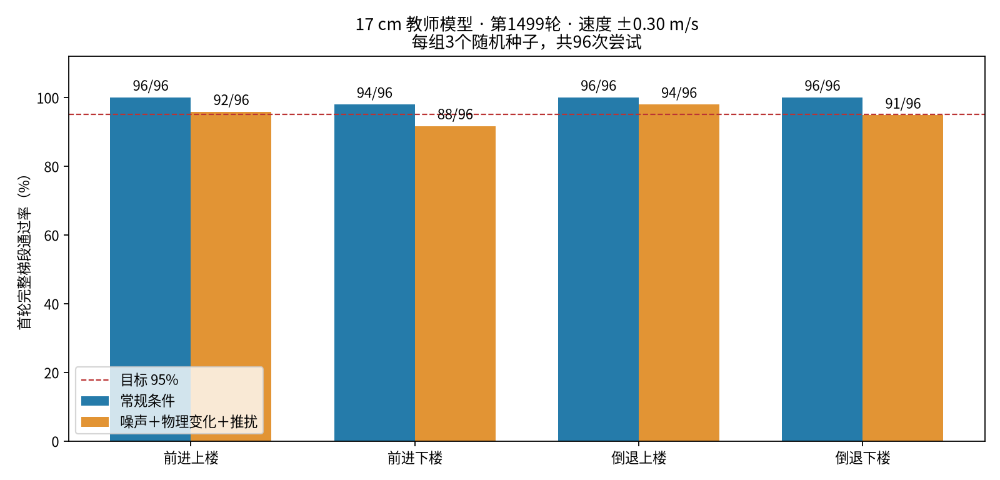

# BPX 四足机器人强化学习

[English](README.md) | **简体中文**

基于 MIRRORME BPX 模型、Isaac Lab 和 RSL-RL，研究**训练时利用地形特权信息、部署时不依赖相机**的四足运动控制。当前目标是 **17 cm 台阶、30 cm 踏面**，支持前进/倒退上楼和下楼。

## 电机参数更新（2026-11-06）

已根据产品规格将髋关节/膝关节峰值扭矩改为 20/40 N·m，并采用额定转速 12/10 rad/s 作为保守训练上限；关节角度和最终位置目标限幅以 URDF 为准。[核对依据、实施细节和未辨识参数](docs/bpx-motor-spec-alignment.zh-CN.md)。下列发布模型及成绩采用旧的统一 30 N·m / 20 rad/s，不能作为新限制下的成绩。首轮 3000 轮盲学生已完成但未达标，老师修复与新限制适配训练已按用户要求暂停，保留第 600 轮检查点；尚未部署实机。

## 已发布实验（2026-11-05，旧电机限制）

- **已完成**：235维地形教师 PPO 训练、本轮1500次迭代，以及17cm三种子常规/扰动测试和低台阶回归。
- **已提供**：[第1499轮教师权重、配置、逐次测试结果和校验清单](pretrained/bpx_stairs17_teacher/)。普通 Git 克隆即可获取，无需 Git LFS。
- **尚未达标**：扰动条件下前进下楼91.7%、倒退下楼94.8%，低于每项至少95%的教师目标。
- **后续阶段**：900维本体历史盲学生首轮已训练评估但未达标；老师修复、新电机限制适配与学生强化继续进行，实机能力尚未验证。当前教师不能直接作为无相机部署策略。

| 17cm测试动作 | 常规条件 | 噪声＋物理变化＋推扰 | 扰动下物理失败 |
|---|---:|---:|---:|
| 前进上楼 | 96/96（100%） | 92/96（95.8%） | 0 |
| 前进下楼 | 94/96（97.9%） | 88/96（91.7%） | 4 |
| 倒退上楼 | 96/96（100%） | 94/96（97.9%） | 0 |
| 倒退下楼 | 96/96（100%） | 91/96（94.8%） | 5 |

速度±0.30m/s，种子2026/2027/2028；每项96次**首轮完整梯段尝试**，不把自动重置后的成功计入。8/12/15cm常规回归为单种子，共384次全部通过。扰动包含观测噪声、摩擦/恢复系数、质量、重心和外推。有限样本通过率不代表实机可靠性。



详细实验设置、模型来源、失败分析及下一步见[最新实验报告](docs/stairs17-results.zh-CN.md)。

## 方法与接口

```text
仿真：45维本体状态 + 3维真实机身线速度 + 187维地形高度
                              ↓
                    PPO教师（235维输入）
                              ↓ 动作监督 / 在线蒸馏
部署目标：最近20帧本体观测 → 盲学生（900维输入） → 12维关节位置残差
```

| 策略 | 任务 | 动作网络输入 | 状态 |
|---|---|---|---|
| 当前教师 | `bpx_stairs17_teacher` | 45＋3＋187＝235维 | 已训练，抗扰动下楼待改进 |
| 目标盲学生 | `bpx_stairs17_blind` | 45×20＝900维 | 首轮已完成，尚未达标 |
| 原始基线 | `bpx_flat` / `bpx_rough` / `bpx_stairs` | Actor 45维，Critic 48维 | 保留用于对照 |

本体45维依次为机身角速度3、重力方向3、速度指令3、关节相对位置12、关节速度12、上一动作12。教师的额外输入为仿真真值；187点高度扫描不是实际相机画面，摩擦/质量/接触力也没有额外拼入当前教师策略输入。它们用于物理随机化、奖励或终止判定。

学生采用 **20帧历史MLP＋RSL-RL在线动作蒸馏**，借鉴特权教师/本体历史学生思路，并非ETH论文TCN、潜变量监督与PMTG的完整复现。控制50Hz、历史约0.4秒；历史**按观测项分块、块内从旧到新**，不能直接把20帧45维观测展平。详见[方法与部署接口](docs/bpx-privileged-blind-training.zh-CN.md)。

## 安装与检查

已实际运行的软件栈：Ubuntu22.04 x86-64、Python3.11、Isaac Sim5.1.0、Isaac Lab2.3.0、RSL-RL3.0.1、PyTorch2.7.0＋CUDA12.8。参考机器为RTX2080SUPER 8GB，512环境；这只是已运行配置，不是所有场景的显存保证。

```bash
git clone https://github.com/Ryon-droid/bpx-rl-train.git
cd bpx-rl-train
./bpx.sh setup
conda activate bpx_train
python scripts/list_envs.py
./bpx.sh contract --task bpx_stairs17_teacher --headless --device cuda:0
./bpx.sh contract --task bpx_stairs17_blind --headless --device cuda:0
```

`setup`需要Conda，会创建新的环境，拒绝覆盖同名环境。首次启动须完成NVIDIA许可提示并可能下载扩展。已有固定依赖环境可执行`./bpx.sh install`。手动安装、原45维模型与MuJoCo用法保留在[基线指南](docs/baseline-guide.zh-CN.md)。

## 查看与复测最新模型

下列命令在仓库根目录、已激活训练环境后执行。

```bash
# 带窗口查看当前教师；普通播放不是固定17cm资格测试。
./bpx.sh play --task bpx_stairs17_teacher \
  --checkpoint pretrained/bpx_stairs17_teacher/model_1499.pt \
  --num_envs 1 --device cuda:0 --seed 2026 --real_time

# 固定17cm、扰动条件、前进；报告分别统计上楼和下楼。
./bpx.sh stairs-eval --task bpx_stairs17_teacher \
  --checkpoint pretrained/bpx_stairs17_teacher/model_1499.pt \
  --step_height 0.17 --num_envs 64 --speed 0.30 --seed 2026 \
  --condition robust --output outputs/stairs17-forward.json --device cuda:0
# 倒退加 --backward；常规条件用 --condition nominal。

# 完整18组：17cm三种子常规/扰动、前后方向，以及8/12/15cm常规回归。
./bpx.sh stairs-suite pretrained/bpx_stairs17_teacher/model_1499.pt \
  review_v1 outputs/stairs17-review
```

完整复测在参考机器约10～15分钟；不启动训练。输出目录中相同前缀已存在时会拒绝覆盖。汇总的`teacher_passed`只检查八项通过率，仍须审查物理失败和低台阶回归。

只核算随附测试数据、不启动仿真：

```bash
python scripts/summarize_stair_suite.py \
  --directory pretrained/bpx_stairs17_teacher/reports \
  --prefix rtx2080_stairs17_balanced_resume_20261105 \
  --height 0.17 --output /tmp/bpx-stairs17-qualification.json
```

## 继续训练与后续蒸馏

```bash
# 从发布权重初始化新电机限制下的修复任务（新优化器、重新计数）。
./bpx.sh train --task bpx_stairs17_repair_teacher \
  --init_checkpoint pretrained/bpx_stairs17_teacher/model_1499.pt \
  --num_envs 512 --max_iterations 1500 --seed 2026 \
  --run_name stairs17_motor_repair --headless --device cuda:0
```

`--max_iterations`是**追加迭代数**；`--resume`不恢复仿真状态、课程进度或随机数状态。`--init_checkpoint`则只初始化兼容权重并重新计数、重建优化器。随附YAML是历史快照，运行时实际读取注册的Python配置，不会自动加载模型旁的YAML。完整训练流程见[17cm训练说明](docs/bpx-stairs17-training.zh-CN.md)。

教师达标后才进行正式盲学生训练。以下是下一阶段命令示例，不表示随附教师已获准进入该阶段：

```bash
./bpx.sh train --task bpx_stairs17_blind \
  --teacher_checkpoint /absolute/path/to/qualified_teacher.pt \
  --num_envs 512 --max_iterations 3000 --seed 2026 \
  --run_name stairs17_blind_v1 --headless --device cuda:0
```

学生训练预算需短跑测速后确定，不能靠删除教师地形输入获得盲策略。正式学生必须独立完成同条件评估，才能考虑部署。

## 仓库结构

```text
bpx.sh                         统一安装、训练、播放、评估与导出入口
source/.../tasks/locomotion/   地形、任务、观测、奖励、课程与PPO/蒸馏配置
scripts/                      训练、评估、导出、历史缓冲与MuJoCo工具
tests/                        不启动Isaac Sim的单元与回归测试
resources/                    BPX机器人模型和网格
pretrained/bpx_stairs17_teacher/ 最新教师、配置、评估证据与SHA256清单
pretrained/bpx_flat/           历史45维平地模型
pretrained/bpx_stairs/         历史45维低台阶模型
docs/                         实验报告、方法、训练与标定文档
```

保留15/16/20cm历史任务作研究对照；当前目标为17cm。运行日志、缓存和大批量视频不进入版本控制。最新教师单独提供`artifact-manifest.json`；原`pretrained/manifest.json`仅描述历史45维模型。

```bash
# 不需要Isaac Sim；需要numpy、torch、mujoco，蒸馏测试还需rsl-rl-lib==3.0.1。
python -m unittest discover -s tests -v
```

阅读顺序：[最新结果](docs/stairs17-results.zh-CN.md) → [17cm训练](docs/bpx-stairs17-training.zh-CN.md) → [教师/盲学生方法](docs/bpx-privileged-blind-training.zh-CN.md) → [电机辨识计划](docs/bpx-calibration-execution-plan.zh-CN.md)。电机辨识和实机SDK接入仍是后续工作，本仓库未包含实机控制闭环。

2026-11-05整理发布检查：28项测试全部通过；另已检查脚本语法、文档链接和18组评估编排。本次未重跑完整GPU仿真，表中结果来自已完成的训练与评估记录。

## 来源与许可证

基于MIRRORME BPX及原训练工程扩展，保留原作者署名与[BSD-3-Clause许可证](LICENSE)。NVIDIA软件另适用其自身许可。

- [BPX机器人资源](https://github.com/mirrormerobotics/BPX)
- [Isaac Lab 2.3.0](https://isaac-sim.github.io/IsaacLab/v2.3.0/source/setup/installation/index.html)
- Lee等，*Learning Quadrupedal Locomotion over Challenging Terrain*，Science Robotics，2020。
- Rudin等，*Learning to Walk in Minutes Using Massively Parallel Deep Reinforcement Learning*，CoRL，2021。

2026-11-06 更新检查：33 项测试全部通过；GPU 已验证实际关节限制、动作限幅及 20 轮训练短跑。新限制下正式训练已暂停在第 600 轮存档，未完成能力评估，该检查点未包含在仓库中。

## 参数辨识软件准备

[PACE 思路下的 BPX 工具与吊架调试流程](docs/bpx-sysid-preparation.zh-CN.md)：离线扫频、只读 SDK 采集、数据检查、MuJoCo/PhysX 固定机身重放、49 维 CMA-ES 与独立验证。实机扫频下发及高频接收侧日志仍需吊架完成后联调，尚无实机辨识结果。原强化学习训练保持暂停。
