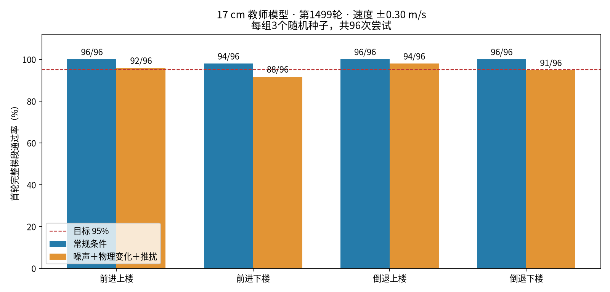

# 17cm教师训练效果与下一步计划

> 历史配置说明：本文中的统一 30 N·m / 20 rad/s 为原实验参数。2026-11-06 运行配置已按电机规格更正；本文历史结果不改写，详见[电机规格核对](bpx-motor-spec-alignment.zh-CN.md)。

实验日期：2026-11-05。

1500轮训练已完成，最终[model_1499.pt](../pretrained/bpx_stairs17_teacher/model_1499.pt)。训练所用代码提交为`e6877c1547358ee720c70a5b959a627fe1b01919`。恢复后的1400轮用时1859.8秒（约31分钟）；18组自动评估全部完成，服务正常退出。模型本地备份已校验：迭代1499、参数有限、优化器存在，SHA256与远端一致。

结论：常规17cm表现稳定，上楼和低台阶能力良好；扰动下楼未达全部项目至少95%的既定目标。当前仍为235维教师，尚未进行正式盲学生蒸馏。

精确17cm台阶，30cm踏面，±0.30m/s，种子2026/2027/2028，每组96次首轮完整梯段尝试。后续自动重置不计成功。扰动包括观测噪声、摩擦/恢复系数、质量、重心及外推。

| 条件 | 动作 | 通过 | 通过率 | 物理失败 | 终点横向超限 |
|---|---|---:|---:|---:|---:|
| 常规 | 前进上楼 | 96/96 | 100.00% | 0 | 0 |
| 常规 | 前进下楼 | 94/96 | 97.92% | 0 | 2 |
| 常规 | 倒退上楼 | 96/96 | 100.00% | 0 | 0 |
| 常规 | 倒退下楼 | 96/96 | 100.00% | 0 | 0 |
| 扰动 | 前进上楼 | 92/96 | 95.83% | 0 | 3 |
| 扰动 | 前进下楼 | 88/96 | 91.67% | 4 | 4 |
| 扰动 | 倒退上楼 | 94/96 | 97.92% | 0 | 2 |
| 扰动 | 倒退下楼 | 91/96 | 94.79% | 5 | 1 |

物理失败和横向超限可能重叠，不能直接相加。常规前进下楼的2次失败均为终点横向超过0.75m。扰动上楼没有物理失败：前进3次横向超限、1次超时，倒退2次横向超限。扰动下楼共9次物理失败，8次细分记录为姿态超限；另1次细分标记被覆盖，保守保留物理失败。

安装的Isaac Lab TerminationManager会在后续终止项命中时覆盖单项原因标记，因此出现总physical_failure为真而base_contact/bad_orientation均假的记录。评估通过判定使用总终止信号，未把此类失败算成成功；下一轮诊断应直接同步记录各物理判据和接触力，避免原因丢失。

## 与强化起始模型对比

只比较同一随机种子2026、相同起始状态和实际物理参数下的17cm扰动测试；不能当作旧模型三种子完整资格结果。

| 动作 | 原15cm第1000轮 | 新17cm第1499轮 | 物理失败：旧→新 |
|---|---:|---:|---:|
| 前进上楼 | 25/32 | 31/32 | 1→0 |
| 前进下楼 | 26/32 | 27/32 | 6→3 |
| 倒退上楼 | 30/32 | 31/32 | 0→0 |
| 倒退下楼 | 31/32 | 32/32 | 0→0 |

## 低台阶回归

8/12/15cm，常规条件、种子2026、前后上下楼共384次，全部通过且无物理失败。每高度每动作32次，这是单种子常规回归，尚非低台阶扰动资格评估。

## 建议后续实验（尚未开展）

1. 先定位下楼失稳来源，分别仅开启观测噪声、材料变化、质量变化、重心变化和推扰，前后方向对照，优先复现2026前进和2027倒退失败。同步记录接触力、姿态和下楼位置。预计10～15分钟；不能从当前组合扰动结果直接断定是摩擦或电机问题。
2. 检查本轮500/1000等中间模型，按最弱组、物理失败和低台阶保持情况选择起点。筛选约5～10分钟；最终轮数不自动等于最好。
3. 按诊断结果小幅调整训练：保留上楼、低台阶和站立训练，适度增加14～17cm下楼及失稳条件的练习，前进倒退保持均衡；检查落足与姿态约束，先短试验再确定权重。建议500～1000轮，约12～25分钟；不降低电机限制、不放宽物理失败判据、不删除推扰。
4. 固定17cm、±0.30m/s、同一三种子复测八组，均至少95%，并复查物理失败、8/12/15cm以及站立/转向保持情况。测试约10～15分钟。95%只是有限样本的仿真目标，不能视为实机可靠性证明。
5. 教师达到目标后，再开始900维本体历史盲学生蒸馏。正式训练前先短跑估算用时，学生必须在不输入地形/真实线速度时独立通过同条件测试，随后才考虑电机辨识后的仿真到实机验证。

上述内容为后续实验计划，尚未执行下一轮训练或正式蒸馏。

## 发布数据与复核

- [最新模型目录](../pretrained/bpx_stairs17_teacher/)提供最终教师、原始环境/PPO配置快照和18份逐次评估记录。
- [资格汇总](../pretrained/bpx_stairs17_teacher/reports/rtx2080_stairs17_balanced_resume_20261105_qualification.json)由12份17cm评估计算；其余6份为8/12/15cm常规回归。
- [校验清单](../pretrained/bpx_stairs17_teacher/artifact-manifest.json)记录各发布文件SHA256及完整原始JSON的SHA256。发布JSON保留全部首轮结果，省略体积较大的逐帧轨迹、初始状态和物理参数数组；检查点路径改为仓库相对路径。
- 原始YAML是恢复训练时的配置快照，包含原机器绝对路径与Python YAML标签；`max_iterations: 1400`是从第100轮恢复后的追加预算，并非从零只训练1400轮。脚本不会自动读取这些YAML。
- 结果来自训练机器上的实际仿真；整理发布时复核了汇总与384次低台阶结果，没有重新运行整套仿真，也未进行新训练。
- 之前四段纯演示视频使用的是强化前的15cm第1000轮教师，不是此处发布的17cm第1499轮教师。个别成功视频不替代群体测试。

当前教师完整权重约5.2MB，不包含盲学生或实机导出成品。历史45维检查点与当前235维教师输入不同，不能直接互换。

## 本次发布检查

2026-11-05本地CPU环境下28项单元/回归测试全部通过；Shell语法、Python编译和Markdown本地链接检查通过。独立18组评估脚本使用归档结果验证了教师/学生任务转发、重复输出拒绝和评估失败退出。该脚本编排检查没有启动仿真；本次没有重跑完整GPU评估。
